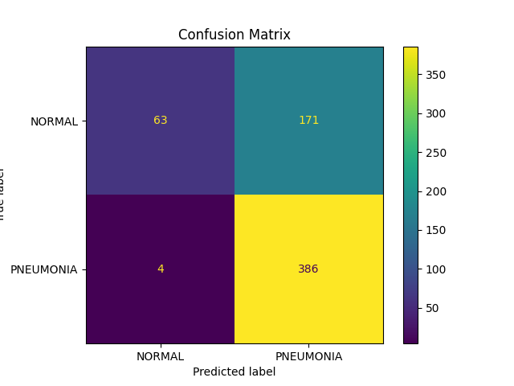
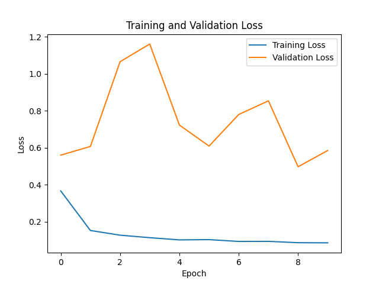
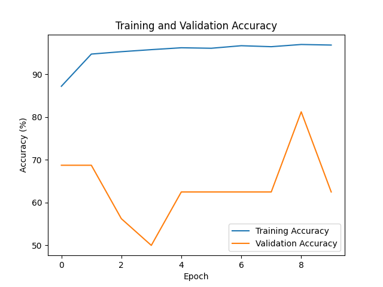

# MedTriage AI

AI-assisted **chest X-ray triage** with a multi-agent pipeline. A PyTorch CNN classifies the X-ray (NORMAL / PNEUMONIA), a local LLM (Ollama) writes a structured preliminary report, a human reviewer approves or rejects it, and the approved report is exported as a PDF.

> ⚠️ Educational project, **not a medical device**. Predictions and reports are preliminary and must be reviewed by a qualified professional.

## Features

- **Input checks**: file and format validation, plus a heuristic check that the image looks like a chest X-ray (resolution, grayscale consistency, brightness range).
- **Pneumonia detection** with a custom CNN trained on chest X-rays.
- **Low-confidence detection**: the orchestrator logs a warning when a prediction's confidence is below 60%.
- **LLM-generated report** (Ollama, `phi3`): risk level, recommendation and disclaimer, in structured JSON.
- **Human-in-the-loop validation**: the reviewer approves or rejects the report before any export.
- **PDF export** with ReportLab: header and footer, pagination, sections.
- **Streamlit dashboard**: upload and analysis, result card with confidence and risk level, statistics, analysis history, medical disclaimer.
- **Logging** of every agent step to a JSON log, used by the dashboard metrics.

## Architecture

```
Streamlit UI (app/streamlit_app.py)
        │
        ▼
Orchestrator Agent (agents/orchestrator_agent.py)
  ├─ validates the image, the X-ray format and the model file
  ├─► Medical Image Classifier Agent ──► tools/classify_xray_tool.py (PyTorch CNN)
  ├─► Medical Report Generator Agent ──► tools/generate_report_tool.py (Ollama LLM)
  └─ logs each step (tools/logger.py)
        │
        ▼
Human validation (tools/human_validation_tool.py) ──► PDF report (tools/pdf_report_generator.py)
```

The orchestration is plain Python. `agents/crewai_workflow.py` also declares the same roles as CrewAI `Agent`s and offers an alternative sequential workflow.

## Model

`ChestXrayCNN` (`models/cnn_model.py`) has 3 convolution blocks (32, 64, 128 filters, with ReLU and max-pooling), then a fully connected layer of 256 units with dropout 0.5, and 2 outputs.

- Input: 224×224 RGB, normalized. Training augmentation: random horizontal flip and ±10° rotation.
- Training: Adam (lr 1e-3), batch size 32, 10 epochs. The best validation checkpoint is saved to `models/model.pth`.

## Results

Evaluation on the test set (624 images), produced by `evaluate_model.py`:

| Metric | Value |
|---|---|
| Accuracy | 0.72 |
| Weighted precision | 0.79 |
| Weighted recall | 0.72 |
| Weighted F1-score | 0.67 |

| Class | Precision | Recall | F1 | Support |
|---|---|---|---|---|
| NORMAL | 0.94 | 0.27 | 0.42 | 234 |
| PNEUMONIA | 0.69 | 0.99 | 0.82 | 390 |

The model almost never misses pneumonia (recall 0.99), but it labels many normal X-rays as pneumonia (NORMAL recall 0.27). For triage, this conservative bias is safer than the opposite, but the false-positive rate is still too high. See the limitations below.

| Confusion matrix | Training loss | Validation accuracy |
|---|---|---|
|  |  |  |

## Tech stack

Python, PyTorch, torchvision, scikit-learn, Ollama, CrewAI, Streamlit, ReportLab, Pillow, NumPy, Matplotlib.

## Project structure

```
agents/      orchestrator, classifier, report generator, CrewAI workflow
tools/       CNN inference, LLM report, X-ray validator, human validation, PDF, logger
models/      CNN definition (weights are not versioned)
app/         Streamlit dashboard
data_loader.py, train_model.py, evaluate_model.py
test_*.py    manual test scripts for each component
```

## Getting started

1. **Install the dependencies**
   ```bash
   pip install -r requirements.txt
   ```
2. **Download the dataset**: [Chest X-Ray Images (Pneumonia)](https://www.kaggle.com/datasets/paultimothymooney/chest-xray-pneumonia) on Kaggle. Extract it to `dataset/chest_xray/`, with `train/`, `val/` and `test/` folders. The dataset is not included in this repository.
3. **Train and evaluate the model** (this creates `models/model.pth` and the figures in `reports/`)
   ```bash
   python train_model.py
   python evaluate_model.py
   ```
4. **Install [Ollama](https://ollama.com) and pull the model**
   ```bash
   ollama pull phi3
   ```
5. **Run the dashboard**
   ```bash
   streamlit run app/streamlit_app.py
   ```

## Tests

The `test_*.py` files are manual scripts that run one component at a time (classifier, report generator, human validation, orchestrator, CrewAI workflow) and print the result. They are not automated assertions. Most of them need the trained model and the dataset.

```bash
python test_orchestrator.py
```

## Limitations

- Low specificity on NORMAL images (recall 0.27), so there are many false positives.
- Simple CNN trained from scratch, with no transfer learning and no tuning of the decision threshold.
- The X-ray check is a heuristic, not a trained model.
- The tests are manual scripts, not an automated test suite.

## Possible improvements

- Use transfer learning (ResNet, DenseNet) with class weighting, and tune the decision threshold.
- Add explainability (Grad-CAM heatmaps) to the dashboard and the PDF.
- Convert the test scripts to `pytest`, with fixtures and assertions.
- Package the app with Docker.
